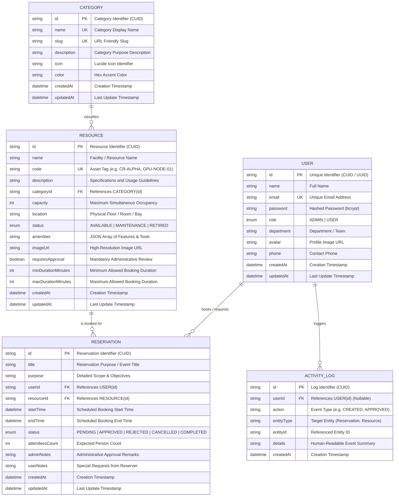

# Entity Relationship (ER) Diagram
## PrimeWave Lab — Resource Reservation Management System (RRMS)

### 1. Conceptual & Logical ER Diagram (Mermaid)



---

### 2. Entity Descriptions & Relationships

| Relationship | Cardinality | Business Meaning | Delete Behavior |
| :--- | :--- | :--- | :--- |
| **User → Reservation** | 1 : Many ($1:N$) | A user can submit multiple reservations over time; each reservation belongs to one user. | `ON DELETE CASCADE` |
| **Resource → Reservation** | 1 : Many ($1:N$) | A resource can have multiple scheduled reservations; each reservation targets one resource. | `ON DELETE CASCADE` |
| **Category → Resource** | 1 : Many ($1:N$) | A category groups multiple resources (e.g., Conference Rooms, GPU Nodes); each resource has one category. | `ON DELETE CASCADE` |
| **User → ActivityLog** | 1 : Many ($1:N$) | Users trigger audit logs upon creating or modifying reservations. System actions may leave `userId` null. | `ON DELETE SET NULL` |

---

### 3. Conflict Prevention Constraints & Indexing Strategy

To guarantee zero overlapping reservations:
1. **Composite Index**: `RESERVATION(resourceId, startTime, endTime)` — optimizes range overlap lookups:
   $$\text{overlap} = (startTime < existing.endTime) \land (endTime > existing.startTime)$$
2. **Status Index**: `RESERVATION(status)` — quick filtering of active locks (`APPROVED`, `PENDING`).
3. **Unique Keys**:
   - `USER(email)`
   - `RESOURCE(code)`
   - `CATEGORY(name)`, `CATEGORY(slug)`

---

### 4. PostgreSQL DDL SQL Definition

```sql
-- Enums
CREATE TYPE "Role" AS ENUM ('ADMIN', 'USER');
CREATE TYPE "ResourceStatus" AS ENUM ('AVAILABLE', 'MAINTENANCE', 'RETIRED');
CREATE TYPE "ReservationStatus" AS ENUM ('PENDING', 'APPROVED', 'REJECTED', 'CANCELLED', 'COMPLETED');

-- User Table
CREATE TABLE "User" (
    "id" TEXT NOT NULL PRIMARY KEY,
    "name" TEXT NOT NULL,
    "email" TEXT NOT NULL UNIQUE,
    "password" TEXT NOT NULL,
    "role" "Role" NOT NULL DEFAULT 'USER',
    "department" TEXT NOT NULL,
    "avatar" TEXT,
    "phone" TEXT,
    "createdAt" TIMESTAMP(3) NOT NULL DEFAULT CURRENT_TIMESTAMP,
    "updatedAt" TIMESTAMP(3) NOT NULL
);

-- Category Table
CREATE TABLE "Category" (
    "id" TEXT NOT NULL PRIMARY KEY,
    "name" TEXT NOT NULL UNIQUE,
    "slug" TEXT NOT NULL UNIQUE,
    "description" TEXT,
    "icon" TEXT,
    "color" TEXT,
    "createdAt" TIMESTAMP(3) NOT NULL DEFAULT CURRENT_TIMESTAMP,
    "updatedAt" TIMESTAMP(3) NOT NULL
);

-- Resource Table
CREATE TABLE "Resource" (
    "id" TEXT NOT NULL PRIMARY KEY,
    "name" TEXT NOT NULL,
    "code" TEXT NOT NULL UNIQUE,
    "description" TEXT NOT NULL,
    "categoryId" TEXT NOT NULL REFERENCES "Category"("id") ON DELETE CASCADE,
    "capacity" INTEGER NOT NULL DEFAULT 1,
    "location" TEXT NOT NULL,
    "status" "ResourceStatus" NOT NULL DEFAULT 'AVAILABLE',
    "amenities" TEXT NOT NULL DEFAULT '[]',
    "imageUrl" TEXT,
    "requiresApproval" BOOLEAN NOT NULL DEFAULT true,
    "minDurationMinutes" INTEGER NOT NULL DEFAULT 30,
    "maxDurationMinutes" INTEGER NOT NULL DEFAULT 480,
    "createdAt" TIMESTAMP(3) NOT NULL DEFAULT CURRENT_TIMESTAMP,
    "updatedAt" TIMESTAMP(3) NOT NULL
);

-- Reservation Table
CREATE TABLE "Reservation" (
    "id" TEXT NOT NULL PRIMARY KEY,
    "title" TEXT NOT NULL,
    "purpose" TEXT,
    "userId" TEXT NOT NULL REFERENCES "User"("id") ON DELETE CASCADE,
    "resourceId" TEXT NOT NULL REFERENCES "Resource"("id") ON DELETE CASCADE,
    "startTime" TIMESTAMP(3) NOT NULL,
    "endTime" TIMESTAMP(3) NOT NULL,
    "status" "ReservationStatus" NOT NULL DEFAULT 'PENDING',
    "attendeesCount" INTEGER NOT NULL DEFAULT 1,
    "adminNotes" TEXT,
    "userNotes" TEXT,
    "createdAt" TIMESTAMP(3) NOT NULL DEFAULT CURRENT_TIMESTAMP,
    "updatedAt" TIMESTAMP(3) NOT NULL
);

CREATE INDEX "Reservation_resource_times_idx" ON "Reservation"("resourceId", "startTime", "endTime");
CREATE INDEX "Reservation_user_idx" ON "Reservation"("userId");
CREATE INDEX "Reservation_status_idx" ON "Reservation"("status");

-- ActivityLog Table
CREATE TABLE "ActivityLog" (
    "id" TEXT NOT NULL PRIMARY KEY,
    "userId" TEXT REFERENCES "User"("id") ON DELETE SET NULL,
    "action" TEXT NOT NULL,
    "entityType" TEXT NOT NULL,
    "entityId" TEXT,
    "details" TEXT,
    "createdAt" TIMESTAMP(3) NOT NULL DEFAULT CURRENT_TIMESTAMP
);
```
