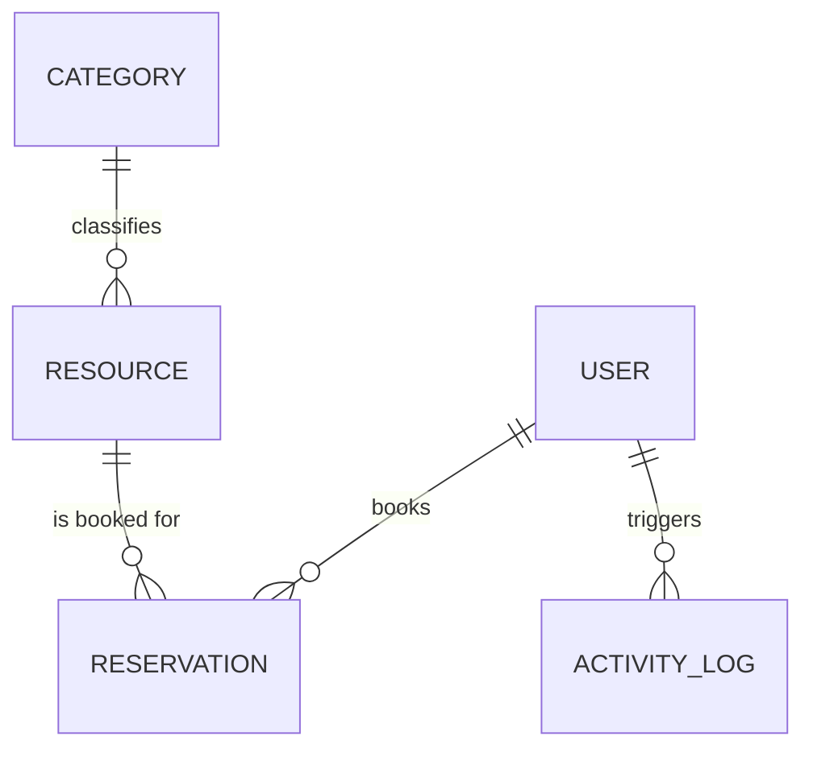

# PrimeWave Lab — Resource Reservation Management System (RRMS)

> **Technical Assessment Submission: Full-Stack Web Development**  
> **Candidate Evaluation Package**

---

## 1. Executive Summary & Business Scenario

### The Problem
Growing organizations frequently manage shared facilities—executive boardrooms, specialized research labs, GPU training clusters, media broadcast suites, and corporate fleet vehicles. Coordinating these resources across cross-functional teams using informal communication and spreadsheets causes:
- **Scheduling confusion and double-bookings**
- **Uncertainty regarding resource availability and operational status**
- **Lack of administrative oversight and usage tracking**

### The Solution: PrimeWave RRMS
**PrimeWave RRMS** is a full-stack, enterprise-grade web application engineered to centralize resource coordination, deterministically prevent scheduling collisions, enforce capacity policies, and provide real-time utilization visibility across the organization.

---

## 2. Technology Stack

| Layer | Technology | Rationale & Highlights |
| :--- | :--- | :--- |
| **Framework** | **Next.js 16 (App Router)** | Modern server/client component paradigm, REST API route handlers. |
| **Language** | **TypeScript (Strict Mode)** | End-to-end type safety across domain models, API payloads, and UI props. |
| **Database** | **PostgreSQL** + **Prisma ORM** | Relational schema with referential integrity, indexes, and migrations. |
| **Local Storage Fallback** | **Zero-Config Persistent Engine** | Ensures the application runs immediately without requiring an external DB setup. |
| **Styling** | **Tailwind CSS v4 + Custom Dark Theme** | Curated palette, glassmorphism cards, micro-animations, and responsive layout. |
| **Data Visualization** | **Recharts** | Interactive charts for peak booking hours and status breakdown. |
| **Icons & UI** | **Lucide React** + **Radix UI** | Polished iconography and accessible interactive components. |
| **Notifications** | **React Hot Toast** | Non-blocking user feedback for conflicts, approvals, and errors. |

---

## 3. Key Features & Engineering Decisions

### ⚡ 1. Real-Time Conflict Detection Engine
- Mathematical validation on every booking request:
  $$\text{Overlap} = (T_{\text{start}} < R_{\text{end}}) \land (T_{\text{end}} > R_{\text{start}})$$
- **Instant Pre-Check**: Checks availability as the user adjusts time inputs *before* submission.
- **Intelligent Slot Suggestions**: When a conflict occurs, the system scans the same day and suggests candidate free slots. Clicking any suggestion auto-fills the form.

### 📅 2. Interactive Schedule & Occupancy Timeline
- Multi-resource daily timeline grid covering 08:00 AM to 08:00 PM.
- Color-coded reservations: Green (Approved), Amber (Pending), Blue (Completed).
- Click any empty time cell to immediately open the booking modal pre-filled with that resource and hour.

### 🛡️ 3. Role-Based Governance & Fast Role Switcher
- **Administrator (Dr. Aaron Vance)**:
  - Approval queue: 1-click Approve or Reject requests with custom administrative remarks.
  - Facility maintenance: Toggle facilities between `AVAILABLE` and `MAINTENANCE`.
  - Administrative override: Option to force-book high-priority requests.
  - Full audit trail review.
- **Regular Member (Jane Wickramasinghe / Kasun Perera)**:
  - Browse facility inventory and specs.
  - Submit booking requests.
  - View personal bookings and cancel if needed.
- **Demo Role Switcher**: A dropdown in the navbar allows reviewers to toggle roles in 1 click.

### 📊 4. Utilization & Analytics Dashboard
- Organizational utilization rate metric.
- Hourly peak booking distribution bar chart.
- Reservation status breakdown donut chart.
- Most high-demand facilities ranking.

---

## 4. Entity Relationship (ER) Diagram

A dedicated Entity Relationship Diagram and data dictionary is provided in [ERD.md](./ERD.md).



Refer to [ERD.md](./ERD.md) for full SQL DDL definitions, relational indexes, and field constraints.

---

## 5. Local Setup & Running the Application

### Prerequisites
- **Node.js**: v18.18+ or v20+
- **npm**: v9+
- *(Optional)* **Docker**: If running PostgreSQL container.

### Step 1: Clone & Install Dependencies
```bash
git clone <your-repository-url>
cd primewave
npm install
```

### Step 2: Environment Configuration
Copy `.env.example` to `.env` (already pre-configured):
```bash
cp .env.example .env
```

### Step 3: Run the Application
Start the development server:
```bash
npm run dev
```

Open [http://localhost:3000](http://localhost:3000) in your browser.

> **Zero-Setup Guarantee**: The application comes pre-loaded with realistic PrimeWave seed data (boardrooms, AI compute nodes, photonics labs, sample reservations, and audit logs) and automatically persists changes to `data/db.json`.

### Optional: Running with Local PostgreSQL
If you wish to run with a local PostgreSQL container:
```bash
# 1. Start PostgreSQL with Docker
docker compose up -d

# 2. Push Prisma Schema
npx prisma db push
```

---

## 6. Demo Personas & Test Credentials

Use the **Role Switcher** in the top navigation bar to test permissions:

| Persona | Role | Department | Purpose in Demo |
| :--- | :--- | :--- | :--- |
| **Dr. Aaron Vance** | `ADMIN` | Operations & Facilities | Approve/reject bookings, manage facilities, view audit logs. |
| **Jane Wickramasinghe** | `USER` | AI & Neural Systems | Book AI clusters and studios, view personal bookings. |
| **Kasun Perera** | `USER` | Robotics & Embedded | Test conflict collision on Boardroom Alpha. |
| **Sarah Chen** | `USER` | Product & Design | Book agile squad pods. |

---

## 7. How to Test Conflict Detection in 30 Seconds

1. Switch user to **Kasun Perera** using the top-right switcher.
2. Click **"Book Resource"**.
3. Select **"The Quantum Executive Boardroom (CR-ALPHA)"**.
4. Set the date to **Today** and time to **09:30 AM to 11:00 AM**.
5. Observe the red **Conflict Warning Banner**:
   - The system alerts you that CR-ALPHA is already booked for *"Q4 Product Roadmap & Executive Review"*.
   - Recommended alternative free slots appear (e.g. `11:30 AM – 1:00 PM`).
   - Clicking a suggested slot automatically updates your reservation times.

---

## 8. Suggested 3–5 Minute Video Demonstration Script

- **0:00 – 0:45 | Introduction & Problem Context**: Introduce PrimeWave Lab's business problem—growing facilities, informal booking confusion, and overlapping reservations.
- **0:45 – 1:45 | Catalog & Real-Time Conflict Detection**: Show the facility catalog. Open the booking modal and demonstrate the real-time conflict detector catching an overlapping slot and recommending free alternative times.
- **1:45 – 2:45 | Visual Occupancy Timeline (Schedule)**: Walk through the multi-resource calendar view showing today's bookings, time blocks, and instant 1-click slot booking.
- **2:45 – 3:45 | Administrative Governance & Approval Workflow**: Switch role to Dr. Aaron Vance (Admin). Demonstrate reviewing pending bookings, 1-click approving/rejecting with custom remarks, and toggling facility maintenance states.
- **3:45 – 4:30 | Analytics, ER Diagram & Technical Architecture**: Show the analytics dashboard (utilization, peak hours), reference the Prisma/PostgreSQL ER diagram, and conclude.

---

## 9. Project Directory Structure

```
primewave/
├── data/                       # Local persistent database store
├── prisma/
│   └── schema.prisma           # PostgreSQL Prisma ORM schema
├── public/                     # Static assets
├── src/
│   ├── app/
│   │   ├── (api)/              # REST API Route Handlers
│   │   │   ├── activity-logs/
│   │   │   ├── analytics/
│   │   │   ├── categories/
│   │   │   ├── reservations/
│   │   │   │   ├── [id]/
│   │   │   │   └── check-conflict/
│   │   │   ├── resources/
│   │   │   └── reset/
│   │   ├── admin/              # Administrative Governance Console
│   │   ├── analytics/          # Analytics & Visual Charts Page
│   │   ├── calendar/           # Visual Schedule & Occupancy Timeline
│   │   ├── dashboard/          # Operations Dashboard
│   │   ├── reservations/       # Reservations Management & Approvals
│   │   ├── resources/          # Shared Facilities Inventory
│   │   ├── layout.tsx          # Root Layout (Dark Theme, Auth, Toaster)
│   │   └── page.tsx            # Executive Landing Page
│   ├── components/             # Reusable UI Components
│   │   ├── BookingModal.tsx    # Live conflict-detecting reservation modal
│   │   ├── CalendarView.tsx    # Multi-resource timeline calendar
│   │   ├── Navbar.tsx          # Top nav with demo role switcher
│   │   ├── ReservationDetailModal.tsx
│   │   ├── ResourceCard.tsx
│   │   └── StatusBadge.tsx
│   ├── lib/
│   │   ├── auth-context.tsx    # Client auth & role switcher provider
│   │   ├── conflict-detector.ts # Collision detection & slot recommendation
│   │   ├── mock-data.ts        # Seed data for PrimeWave Lab
│   │   └── storage.ts          # Storage repository layer
│   └── types/
│       └── index.ts            # TypeScript domain interfaces
├── docker-compose.yml          # PostgreSQL 16 container definition
├── ERD.md                      # Detailed ER Diagram & SQL DDL
└── package.json
```

---

*Submitted for PrimeWave Lab Technical Assessment — Resource Reservation Management System.*
